<p align="center">
  
</p>

<h1 align="center">wLib</h1>

<p align="center">
  <b>A cross-platform desktop game manager for F95Zone</b>
</p>

<p align="center">
  <a href="https://github.com/kirin-3/wLib/releases"></a>
  <a href="LICENSE"></a>
  
  
  
</p>

---

wLib keeps your F95Zone games in one place. It tells you when a game has an update, helps you install it, and launches it for you, on Linux or Windows.

It started as an open-source answer to Windows-only managers like XLibrary. On Linux it can run Windows games through Wine or Proton. On Windows it just launches them directly.

## Features

### Your library

- Add games with cover art, tags, ratings, Markdown notes, PDF attachments and a play status. wLib tracks how long you've played each one.
- Point wLib at a folder of game installs and import several at once. It guesses titles, versions and engines from what it finds, so you can correct them after importing.
- See a game's screenshots from its F95Zone thread in the detail window, and color-code tags so they are easy to spot.
- Open a game's **Journal** to see sessions and playtime by version, including a **Before journal** row for older playtime. The **Unplayed update** collection and **Unplayed** badge flag installed versions you have not played for five minutes yet, once a last played version is known.
- Sort games into your own collections, which show up as tabs above the library. Save a filter and sort you use often, and get it back with one click.
- Add your own play statuses when the built-in choices don't fit, and filter by them like any other status.
- Keep a wishlist of games you haven't installed yet. wLib lets you know when one of them is marked Completed on F95Zone.
- When you finish a game, wLib remembers which version you finished. The **New since finished** collection shows finished games that have had updates since.
- Give a game more than one executable if it comes in several parts. One of them stays the default for the Play button.

### Updates and installing

- Check your whole library for updates in one go. wLib compares your versions with F95Zone and fills in missing details from the thread page.
- Choose **Skip version <version>** from a game's menu or detail window to hide that release, and **Stop skipping <version>** to undo it. Checks continue; a different release shows up again. Changing the installed version clears the skip.
- On Linux, new releases and newly completed wishlist games can trigger one desktop notification after an automatic check, or a manual check that finishes while you are away. Turn **Desktop notifications** off under **Updates > Automatic Checking**.
- Install a new game or an update straight from a downloaded `.zip`, `.7z` or `.rar`. wLib puts it in your library folder, moves your saves over and removes the old version. It also notices matching archives in your Downloads folder. For `.7z` and `.rar` you need 7-Zip on Windows, or `7z`, `bsdtar` or `unrar` on Linux.
- wLib can check GitHub for a newer version of itself from the Updates page.

### Saves and tools

- Choose the saves folder for a game, make backups, and merge or restore a backup after an update. You can keep all backups or only the newest few for each game.
- Ren'Py games get a developer-console switch and `.rpa` archive extraction, either into a separate folder or in place.
- RPG Maker MV/MZ games can have their encrypted assets decrypted, with a switch that makes the game load the decrypted copies.

### Moving and syncing your library

- Bring your library over from F95Checker, Atlas, XLibrary or f69.
- Back up everything to one JSON file and restore it on another machine, including Linux to Windows and back. You can protect the file with a passphrase.
- Keep your library in sync between computers through a shared folder (Syncthing, MEGA and so on), Dropbox or Google Drive, with optional encryption. File paths and launch settings stay on each computer. The [privacy policy](PRIVACY.md) explains exactly what gets synced.
- Journal sessions, last played versions, and skipped versions travel with user state in backups and sync. Sync replaces the journal with the newer library's sessions; it does not combine sessions played offline on two computers.

### Launching

- Works with Ren'Py, Unity, Unreal, Godot, RPG Maker (XP, VX, MV, MZ), Wolf RPG and native Linux games. wLib works out the engine from the thread or the game folder.
- On Windows, `.exe`, `.bat` and `.cmd` files run directly, `.jar` games run through Java, and HTML games open in your browser. Playtime isn't tracked for HTML games.
- On Linux you can pick native, Wine, Proton, an RPG Maker Linux runner or your own command for each game. wLib also has:
  - automatic fixes for common black screens in RPG Maker and NW.js games
  - a Japanese locale option for games that need it
  - a Wayland toggle
  - one-click installs of common runtimes (DirectX, VC++ redistributables, fonts, RPG Maker RTPs)
  - optional Cheat Engine (Lunar Engine) for Wine and Proton games

  None of these options appear on Windows. If you bring a library over from Linux, switch any game that uses a Linux-only mode back to Auto Detect.

### On F95Zone

The Chrome and Firefox extension adds **Add to wLib**, **Wishlist** and **Open in wLib** buttons to F95Zone threads. It keeps itself up to date. See [Browser extension](#browser-extension) for setup.

### Everything else

Light and dark themes, an accent color, an adjustable text size, a motion toggle, and the whole thing is open source: app, interface and extension. The **Diagnostics** page copies a report for bug reports and opens the app log folder.

## Screenshots

<table>
  <tr>
    <td align="center"><b>Library</b></td>
    <td align="center"><b>List view</b></td>
  </tr>
  <tr>
    <td>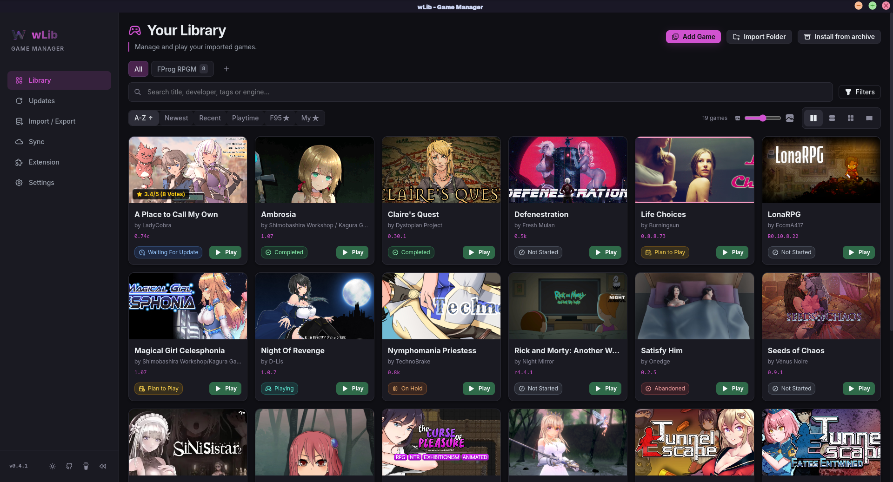</td>
    <td>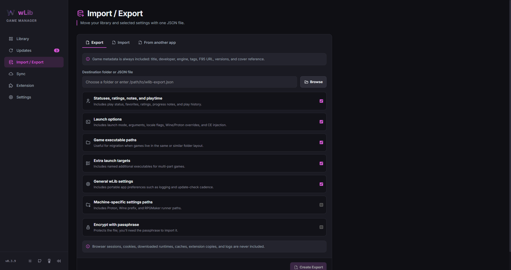</td>
  </tr>
  <tr>
    <td align="center"><b>Game details</b></td>
    <td align="center"><b>Launch options</b></td>
  </tr>
  <tr>
    <td>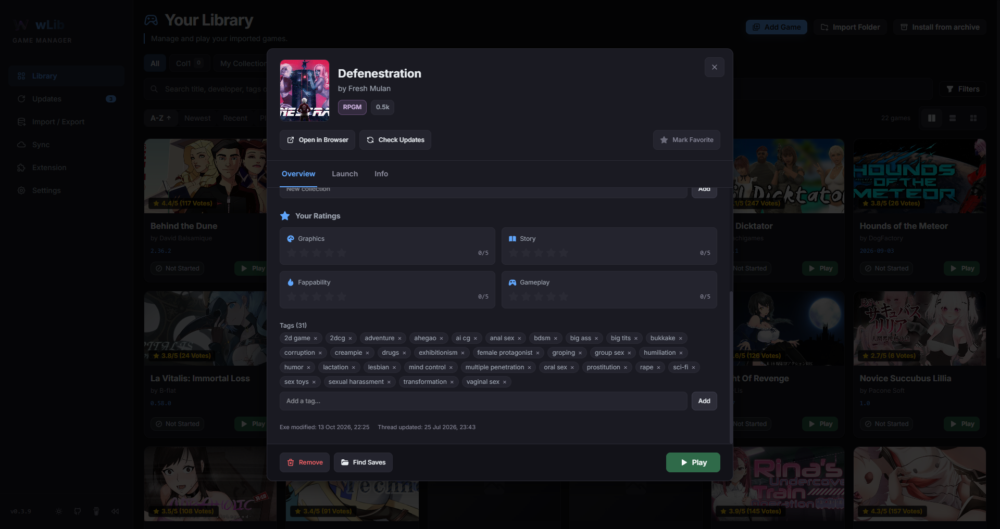</td>
    <td>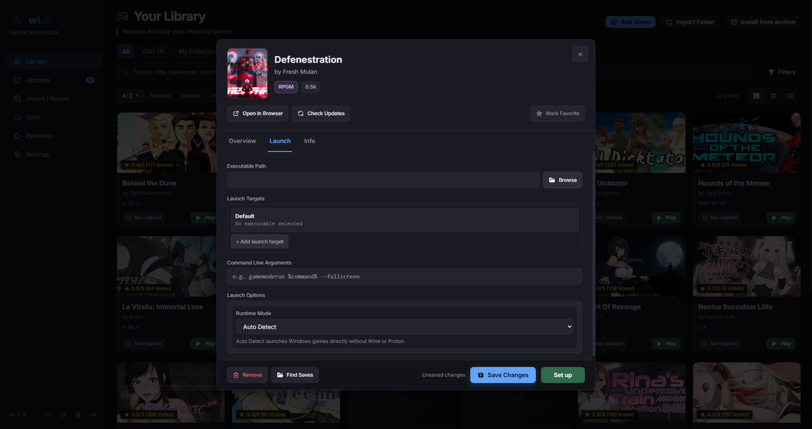</td>
  </tr>
  <tr>
    <td align="center"><b>Updates</b></td>
    <td align="center"><b>Browser extension</b></td>
  </tr>
  <tr>
    <td>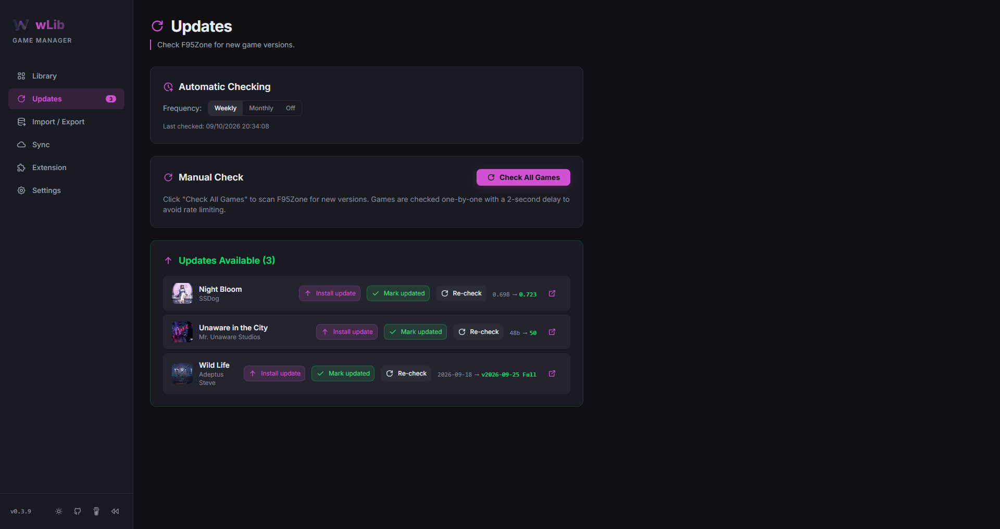</td>
    <td>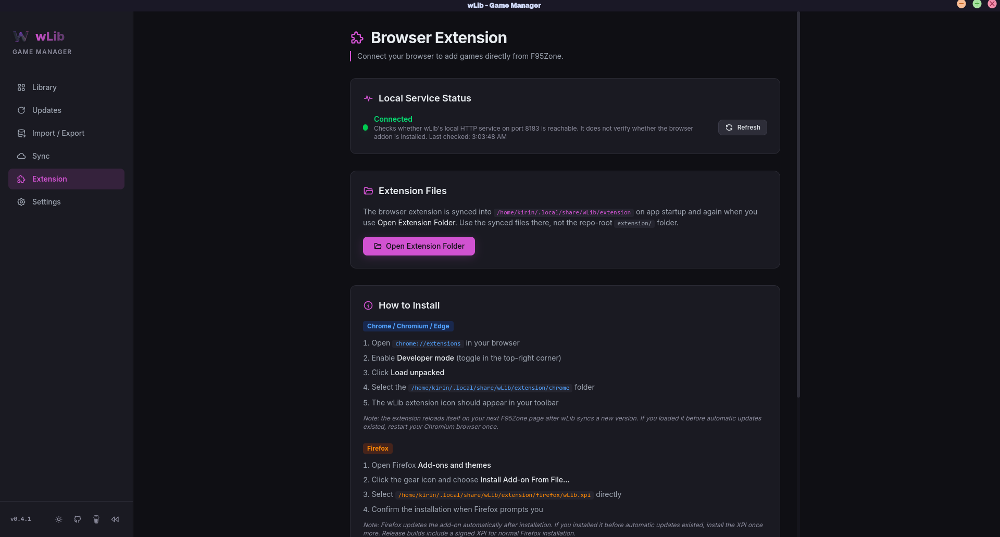</td>
  </tr>
</table>

<details>
<summary>More screenshots</summary>

<table>
  <tr>
    <td align="center"><b>Compact sidebar</b></td>
    <td align="center"><b>Game info and finished version</b></td>
  </tr>
  <tr>
    <td>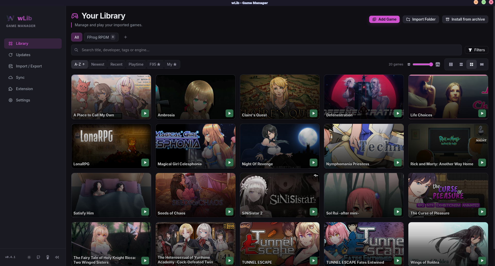</td>
    <td>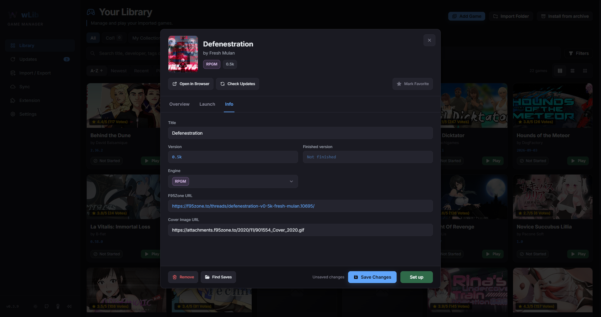</td>
  </tr>
  <tr>
    <td align="center"><b>Ratings and tags</b></td>
    <td align="center"><b>Backup and restore</b></td>
  </tr>
  <tr>
    <td>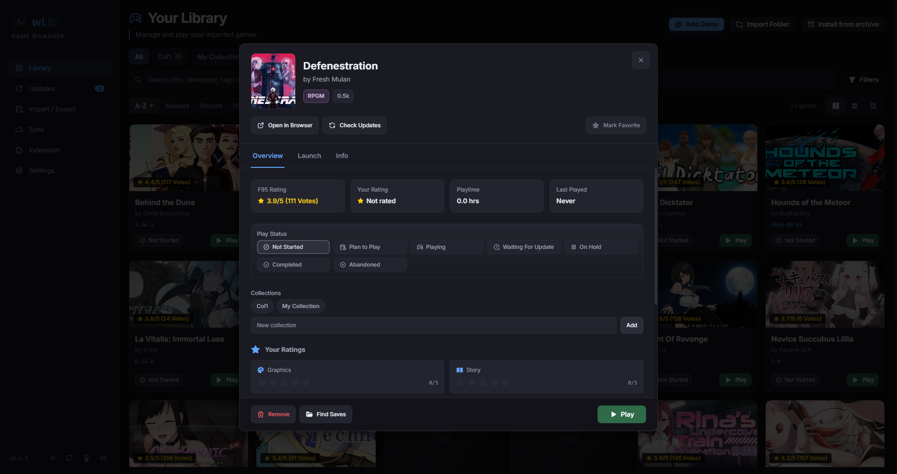</td>
    <td>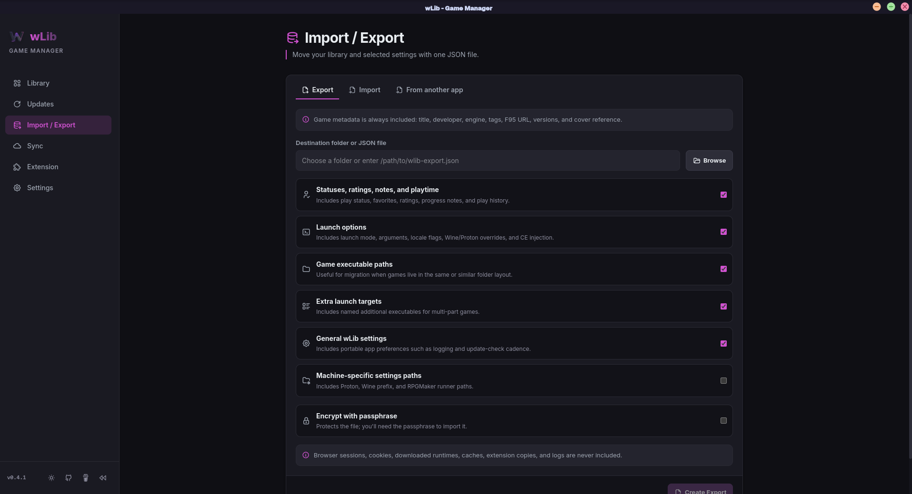</td>
  </tr>
  <tr>
    <td align="center"><b>Import from another app</b></td>
    <td align="center"><b>Sync</b></td>
  </tr>
  <tr>
    <td>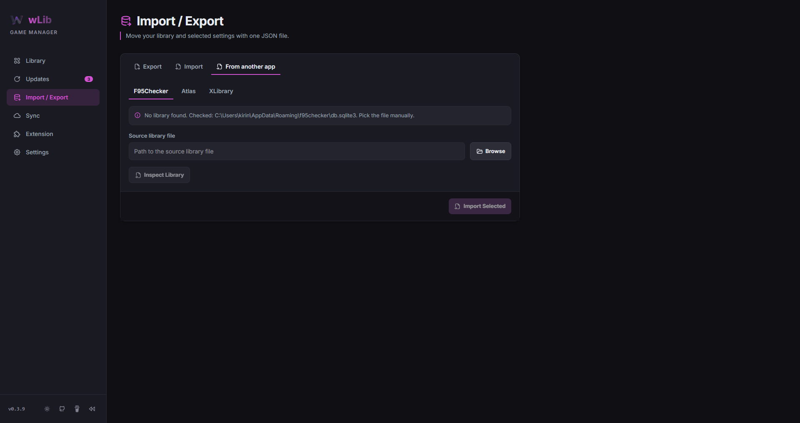</td>
    <td>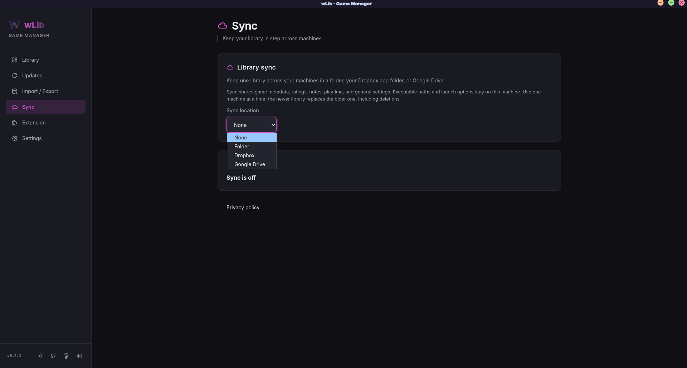</td>
  </tr>
  <tr>
    <td align="center"><b>Settings</b></td>
    <td align="center"><b>Library folder and appearance</b></td>
  </tr>
  <tr>
    <td>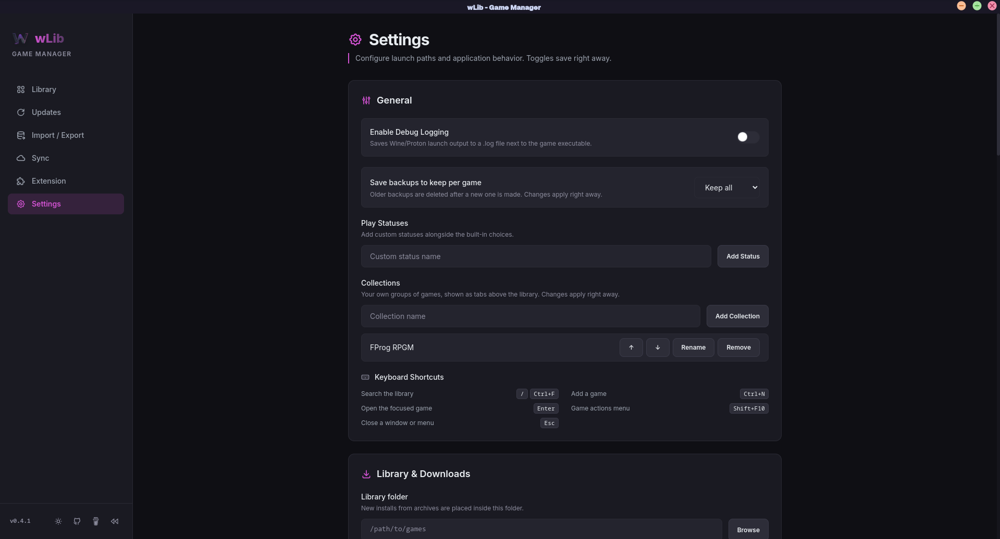</td>
    <td>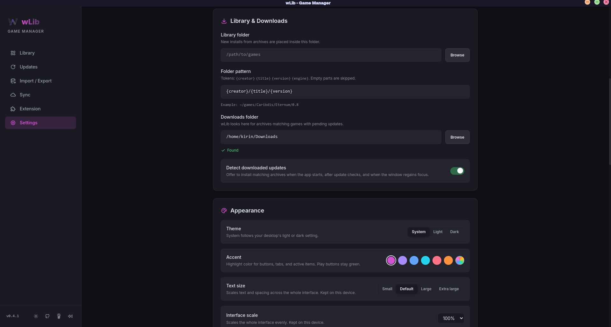</td>
  </tr>
  <tr>
    <td align="center"><b>Wine and Proton</b></td>
    <td align="center"><b>Tools and Ren'Py</b></td>
  </tr>
  <tr>
    <td>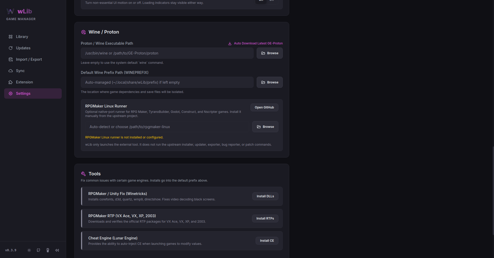</td>
    <td>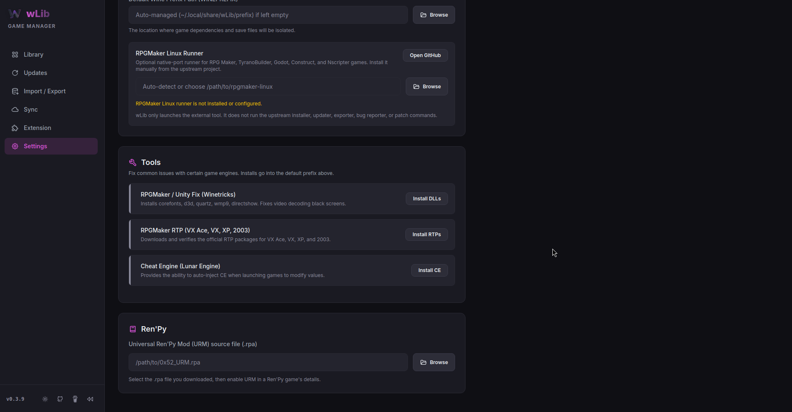</td>
  </tr>
</table>

</details>

## Installing

Download wLib from the [Releases](https://github.com/kirin-3/wLib/releases) page. The Windows downloads include SHA-256 checksums if you want to check a file.

### Windows

There are two Windows downloads. Pick one:

- **Installer** (`wLib-<version>-windows-x64.msi`): installs wLib for your user account and adds a Start Menu shortcut. Later versions install over it.
- **Portable** (`wLib-<version>-windows-x64-portable.zip`): extract it anywhere and run `wLib.exe`.

You don't need Python, Wine or anything else. Your library is stored in `%LOCALAPPDATA%\wLib` either way, and it stays there if you uninstall.

The Windows builds aren't signed yet, so the first time you open wLib, Windows shows "Windows protected your PC". Click **More info**, then **Run anyway**. For the portable ZIP you can also right-click the file before extracting, open **Properties** and tick **Unblock**.

### Linux

Choose whichever format suits your distro.

**AppImage**, which works on most distros:

```bash
chmod +x wLib-*.AppImage
./wLib-*.AppImage
```

If it won't start, you may need FUSE. On Ubuntu 22.04 and newer, install `libfuse2`.

**Debian, Ubuntu, Mint:**

```bash
sudo apt install ./wLib-*-linux-x86_64.deb
```

**Fedora and other RPM distros:**

```bash
sudo dnf install ./wLib-*-linux-x86_64.rpm
```

**Arch** (AUR package `wlib-bin`):

```bash
paru -S wlib-bin
```

**Plain archive:**

```bash
tar xzf wLib-*-linux-x86_64.tar.gz
cd wLib-*/
./wlib
```

**Flatpak** (single-file bundle, for immutable distros and Steam Deck desktop mode):

```bash
flatpak install --user wLib-<version>-x86_64.flatpak
flatpak run io.github.kirin_3.wLib
```

The Flatpak reuses your existing library at `~/.local/share/wLib`, so you can switch formats without losing games. Games and runners still run on the host: install Wine/Proton, winetricks and archive extractors on the host as below.

Your library is stored in `~/.local/share/wLib`.

### Optional extras

wLib runs on its own, but some games need a bit more:

| You want to | Install |
|---|---|
| Play Windows games on Linux | Wine, or use Proton (wLib can download Proton-GE for you) |
| Use the one-click runtime installers on Linux | Winetricks |
| Play `.jar` games | Java |
| Install games from `.7z` or `.rar` | 7-Zip on Windows; `7z`, `bsdtar` or `unrar` on Linux |

For example, on Ubuntu or Debian: `sudo apt install wine winetricks`.

## Browser extension

The extension adds wLib buttons to F95Zone threads. It only talks to wLib on your own computer (port `8183`), so wLib has to be running for the buttons to work.

If F95Zone challenges wLib's own requests, the extension can retry them using your browser's sign-in, so threads that are only visible when logged in still load.

wLib keeps the extension files in its data folder. Click **Open Extension Folder** in wLib to find them.

### Chrome, Brave, Edge and other Chromium browsers

1. Go to `chrome://extensions/`.
2. Turn on **Developer mode** (top right).
3. Click **Load unpacked** and pick the `chrome` folder inside the extension folder.
4. Open any F95Zone thread. The wLib buttons should now appear.

### Firefox

1. Open **Add-ons and themes**.
2. Click the gear icon, then **Install Add-on From File...**.
3. Pick `firefox/wLib.xpi` inside the extension folder and confirm.

Don't load the `extension/` folder from this repository in Firefox. Use the `.xpi` file.

### Updates

The extension updates itself in both browsers, so you only have to install it once. If you set it up before automatic updates were added (before wLib 0.3.9), restart Chrome once, or install the Firefox `.xpi` one more time.

If the extension says your wLib app is out of date, update wLib. The buttons keep working in the meantime, but some may not behave correctly.

## Troubleshooting

**The window is blank or crashes on startup (Linux).** wLib checks your GPU on startup. If it crashes with hardware acceleration, it switches to software rendering on the next launch by itself. The details are logged in `~/.local/share/wLib/renderer-diagnostics.log` (`%LOCALAPPDATA%\wLib\renderer-diagnostics.log` on Windows).

**A Windows game shows a black screen on Linux.** Try Proton instead of Wine in the game's settings, and make sure its runtimes are installed with the one-click installers.

**More detail for a bug report.** Open **Diagnostics** from the Settings footer to copy a report or open the app log folder. The app log is always on at `~/.local/share/wLib/logs/wlib.log` (`%LOCALAPPDATA%\wLib\logs\wlib.log` on Windows). Turn on **Enable Debug Logging** in Settings to save a game's launch output next to its executable.

## Reporting bugs

[Open an issue](https://github.com/kirin-3/wLib/issues/new?template=bug_report.yml) and tell us:

- what you did, what you expected, and what happened instead
- your OS: the Windows version, or your Linux distro and whether you use X11 or Wayland
- how you installed wLib (installer, portable ZIP, AppImage, package, or from source)
- your Wine or Proton version, if the game runs through one
- logs, if you have them (see Troubleshooting above)

## Building from source

You'll need Python 3.12, Node.js 22.12 or newer, and Git.

**Linux:**

```bash
git clone https://github.com/kirin-3/wLib.git
cd wLib
cd ui && npm ci && npm run build && cd ..
./wlib.sh
```

`wlib.sh` sets up a Python virtual environment and installs what it needs the first time you run it. GTK 3 and PyGObject are optional; they add native desktop integration on Linux.

**Windows (PowerShell):**

```powershell
git clone https://github.com/kirin-3/wLib.git
Set-Location wLib
py -3.12 -m venv .venv
.\.venv\Scripts\python.exe -m pip install -r requirements-windows.txt
Set-Location ui
npm ci
npm run build
Set-Location ..
.\.venv\Scripts\python.exe main.py
```

To build release packages, see [Build & Packaging](docs/build.md).

## Contributing

Help is welcome, whether it's an RPG Maker quirk you tracked down or a cleanup in the interface code. Read the [contributing guide](CONTRIBUTING.md) before opening a pull request. It covers setup, tests and checks.

To work on the interface with live reload, run this from the repository root after `npm ci` in `ui/`:

```bash
DEV_MODE=1 python main.py
```

wLib starts the Vite dev server for you and loads the interface from it, so your changes show up right away. On Windows PowerShell, set `$env:DEV_MODE = "1"` first. You can also run `npm run dev` in `ui/` on its own and open the interface in a normal browser; it uses fake data there.

To check the backend without opening a window, run `python scripts/smoke_backend.py`.

How the code fits together is explained in the [developer documentation](docs/README.md).

## License

wLib is licensed under the [GNU General Public License v3.0 or later](LICENSE). The [privacy policy](PRIVACY.md) explains what wLib stores and what it sends.
