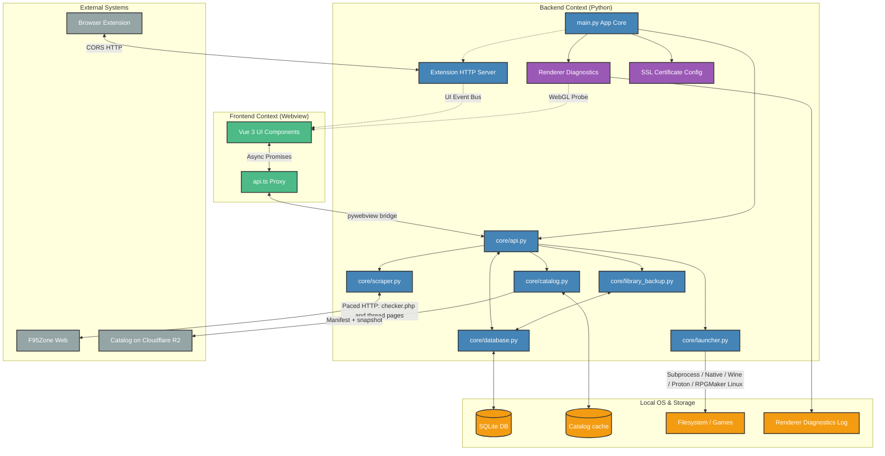

# Architecture Overview

wLib uses the same Vue frontend, Python backend, and Qt WebEngine desktop shell on Linux and Windows. Host-specific paths and launcher capabilities are resolved in `core/host_platform.py`.

## High-Level System Diagram

## Backend Module Map

| Area | Modules |
|------|---------|
| App shell and bridge | `main.py`, `core/api.py`, `core/database.py`, `core/host_platform.py` |
| Library migration and sync | `core/library_backup.py`, `core/library_sync.py`, `core/external_import.py`, `core/litedb.py`, `core/backup_format.py` |
| Game files and library tools | `core/archive_install.py`, `core/game_scan.py`, `core/game_saves.py`, `core/game_attachments.py`, `core/game_covers.py` |
| Mod tools | `core/game_tools.py`, `core/renpy_tools.py`, `core/rpgm_tools.py` |
| Launching and updates | `core/launcher.py`, `core/game_sandbox.py`, `core/desktop_notify.py` |
| Scraping, catalog, and extension bridge | `core/scraper.py`, `core/f95zone.py`, `core/catalog.py`, `core/catalog_format.py`, `core/game_lookup.py`, `core/store_links.py`, `core/extension_bridge.py`, `core/extension_ws.py` |
| Diagnostics and logs | `core/app_log.py`, `core/diagnostics.py` |

`core/versions.py` holds the normalized version comparison shared with the UI. See [Backend Systems](backend.md) for runtime behavior and [Database & Schema](database.md) for persistence.

## Tech Stack Overview

- **Backend Environment**: Python 3.12
- **Desktop Window Manager**: PyWebView with Qt WebEngine on Linux and Windows (Windows releases bundle PyQt6)
- **Frontend Framework**: Vue 3 (Composition API) + TypeScript + Vite + TailwindCSS
- **Database**: SQLite3 (Local file-based database)
- **F95 Requests**: Python urllib with TLS verification, batch version checks, HTML metadata parsing, and an optional browser-extension fallback for challenged or login-gated pages
- **Game Catalog**: Optional read-only SQLite snapshot downloaded from Cloudflare R2, used for store-page metadata and catalog-backed version checks
- **Packaging**: PyInstaller and release scripts for Linux AppImage/tar.gz/DEB/RPM/AUR/Flatpak, a source-built Nix flake, plus Windows x64 portable ZIP and per-user MSI

## Platform Paths

`core/host_platform.py` owns the default locations used by the database, scraper, extension sync, and diagnostics:

| Resource | Linux default | Windows default |
|----------|---------------|-----------------|
| App data | `~/.local/share/wLib` | `%LOCALAPPDATA%\wLib` |
| Database | `~/.local/share/wLib/wlib.db` | `%LOCALAPPDATA%\wLib\wlib.db` |
| Browser extension copies | `~/.local/share/wLib/extension/` | `%LOCALAPPDATA%\wLib\extension` |
| PyWebView storage | `~/.local/share/wLib/webview/` | `%LOCALAPPDATA%\wLib\webview` |
| Cache root | `~/.cache` | `%LOCALAPPDATA%\wLib\cache` |
| Renderer diagnostics | `~/.local/share/wLib/renderer-diagnostics.log` | `%LOCALAPPDATA%\wLib\renderer-diagnostics.log` |
| App log | `~/.local/share/wLib/logs/wlib.log` | `%LOCALAPPDATA%\wLib\logs\wlib.log` |
| Game catalog cache | `~/.local/share/wLib/catalog.db` + `catalog.json` | `%LOCALAPPDATA%\wLib\catalog.db` + `catalog.json` |
| Local covers | `~/.local/share/wLib/covers/` | `%LOCALAPPDATA%\wLib\covers\` |
| Sandbox storage | `~/.local/share/wLib/sandbox/<game id>/` | `%LOCALAPPDATA%\wLib\sandbox\<game id>\` |
| Save backups | `~/.local/share/wLib/save-backups/<game id>/` | `%LOCALAPPDATA%\wLib\save-backups\<game id>\` |
| PDF attachments | `~/.local/share/wLib/attachments/<game id>/` | `%LOCALAPPDATA%\wLib\attachments\<game id>\` |
| Sync snapshot | `~/.local/share/wLib/sync/last-local.json` | `%LOCALAPPDATA%\wLib\sync\last-local.json` |

`WLIB_DATA_DIR` overrides the app-data root and `WLIB_CACHE_DIR` overrides the cache root. Linux also respects `XDG_DATA_HOME` and `XDG_CACHE_HOME`; an existing legacy `~/.local/share/wLib` library is retained when the configured XDG data directory does not yet exist. On Windows, a missing `LOCALAPPDATA` falls back to `~/AppData/Local/wLib`.

MSI and portable Windows builds share the same user-data location; extracting a portable ZIP does not move the library beside the executable.

Upgrade cleanup removes legacy `browser_session/` and `playwright/` directories inside the app data root in the background. Shared caches such as `~/.cache/ms-playwright` and custom browser paths are left untouched. The legacy `playwright_browsers_path` setting is removed from the database and skipped during backup import.

## Platform Capabilities

`Api.get_platform_capabilities()` exposes host capabilities and paths through the typed frontend bridge. Windows offers Auto Detect for native `.exe`, `.bat`, `.cmd`, `.jar`, and HTML targets. Linux additionally offers Linux Native, Wine/Proton, and the optional RPGMaker Linux runner, plus runtime installers, Wayland options, and Cheat Engine injection.

The frontend hides unavailable actions, while backend guards reject unsupported runtime operations. Imported per-game Linux launch options remain stored on Windows; users select Auto Detect before launching. JSON import skips global path settings written for the other OS and reports them in the inspection warnings.

On Flatpak, `core/host_platform.py` keeps game processes and external tools on the host through `flatpak-spawn --host`, with process supervision for tracked launches. Sandbox-only environment variables such as `LD_LIBRARY_PATH` are not forwarded. The same lookup and command helpers cover runner discovery, archive tools, runtime installers, and notifications.

## Process Isolation & Communication

wLib operates across two distinct contexts that never directly share memory:

1. **Python Backend Process (`main.py`)**:
   - Manages the entire lifecycle of the application.
   - Configures SSL certificates and Qt runtime environment.
   - Installs the rotating app log under the data directory.
   - Bootstraps the local SQLite database.
   - Starts the background game-catalog refresh when the catalog is enabled.
   - Removes app-owned legacy browser data in a background thread.
   - Starts the `http.server` daemon thread for the browser extension.
   - Starts the library sync watcher and allows a final sync push on exit.
   - Instantiates the `pywebview` window and maps a Python class object (`Api`) to the JavaScript runtime.
   - Logs Qt and browser renderer diagnostics on both platforms; Linux release launchers handle GPU detection and the crash guard.

2. **TypeScript UI Context (Vue / Vite)**:
   - Runs purely inside the WebView constraint and lacks direct Node.js or native filesystem access.
   - Interacts with Python backend purely through async calls routed strictly via `window.pywebview.api`.
   - Python can also spontaneously send data to the frontend by executing JavaScript snippets inside the webview using `webview.evaluate_js()`. This is how background events like "Playtime Updated" or "Extension Add Request" are propagated into Vue's reactivity system.

## The `DEV_MODE=1` Loop

When executing in development mode (`DEV_MODE=1`), the Python backend skips loading the static built Vue files `ui/dist/`. Instead, it forcefully navigates the Webview frame to `http://localhost:5173`, allowing Vite's Hot Module Replacement (HMR) to work perfectly alongside the native Python app.

PowerShell sets this with `$env:DEV_MODE = "1"`. `main.py` starts `npm` on Linux and `npm.cmd` on Windows; see [Running the App Locally](../CONTRIBUTING.md#running-the-app-locally) for the browser-only development and desktop build/run paths.

## Renderer Diagnostics System

wLib logs Qt backend selection and WebGL renderer details on both platforms. Windows uses Qt's native platform selection and writes to `%LOCALAPPDATA%\wLib\renderer-diagnostics.log`. Linux release launchers add the following GPU compatibility behavior:

- **GPU Detection**: Probes GPU capabilities using `glxinfo`, `/sys/class/drm/`, and environment variables to determine hardware acceleration availability
- **Crash Guard**: Maintains `<data dir>/.gpu_crash_guard` to automatically fall back to software rendering after a GPU crash
- **Diagnostic Logging**: Logs Qt backend selection, GPU detection reason, renderer details, and WebGL probe results to `<data dir>/renderer-diagnostics.log`
- **Browser Renderer Probe**: Executes WebGL detector scripts in the PyWebView to capture the browser's GPU renderer information
- **AppImage Integration**: The AppRun script performs parallel GPU detection and logs launch context to `<data dir>/appimage-launch.log`

This system ensures wLib works reliably across diverse Linux configurations with varying GPU drivers and display servers.
